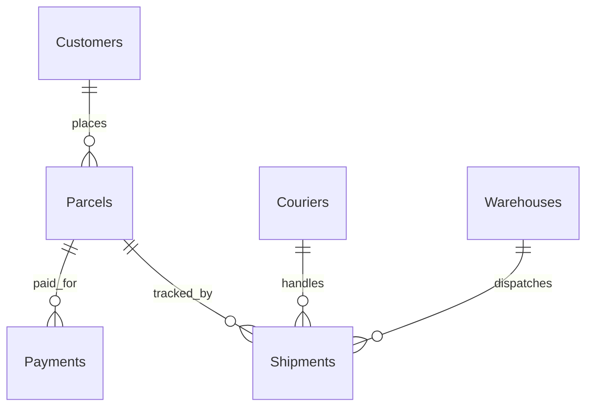

<div align="center">

# TCS Logistics — Karachi Branch
### Operational Performance Optimization with SQL Server

**Delivery SLA · Returns · Courier Workload · Warehouse Capacity · Payment Reconciliation · Shipment Tracking**


**SQL-based investigation of parcel operations, fulfillment exceptions and financial visibility using a simulated logistics dataset.**

[Overview](#executive-summary) · [Data Model](#sql-database--data-model) · [Problems](#six-business-problems) · [SQL](#sql-analysis-highlights) · [Findings](#reported-findings--evidence-quality) · [Roadmap](#future-improvements)

</div>

<!-- Drag your banner image directly into GitHub's README editor ABOVE this line.
     GitHub will create the hosted user-attachments image URL. -->

> **Independence disclaimer:** This is an educational, independently developed case study using synthetic data and the TCS Karachi branch as a business scenario. The operational problems and metrics are not verified internal TCS results. It is not a sponsored or official TCS project.
>
> **Data validation notice:** The presentation reports some results from an expanded or modified dataset that **cannot be reproduced from the attached SQL script alone**. Reported presentation metrics are distinguished from directly inspectable source data below.

---

## Executive Summary

A logistics branch needs dependable insight into shipment turnaround, returns, assignment fairness, warehouse throughput and payment settlement. Even a simple relational model can reveal operational exceptions—but only when records, status definitions and KPI denominators are consistent.

For this project, I created a **SQL Server relational model** representing customers, couriers, warehouses, parcels, shipments and payments. I then applied SQL queries to investigate six business questions related to fulfillment and financial operations.

### My contribution
- Designed six related operational tables using primary and foreign keys.
- Populated the database with **demonstration records** for logistics transactions.
- Investigated shipment duration, return outcomes, daily dispatch volume, payment status and prolonged in-transit shipments.
- Documented proposed improvements in tracking, operational reporting and financial reconciliation.
- Reviewed the original SQL and presentation for data-quality and measurement risks.

| Project attribute | Detail |
|---|---|
| **Role** | Data Analyst — SQL Portfolio Case Study |
| **Technology** | Microsoft SQL Server / T-SQL |
| **Industry context** | Courier & logistics |
| **Scenario** | Karachi branch performance |
| **Database** | `TCS_LogisticsDB` |
| **Core tables** | 6 |
| **Business questions** | 6 |
| **Source records** | 25 customers, 25 couriers, 25 warehouses, 25 parcels, 25 shipments, 25 payments in the supplied INSERT blocks |
| **Delivery** | SQL script + analysis presentation + README |
| **Not implemented** | Live APIs, deployed operations system or verified Power BI solution |

---

## Business Context

The case study is organized around these questions:

1. **Delivery performance:** Which shipments exceed a proposed 48-hour delivery target?
2. **Returns:** How do return outcomes differ by payment method?
3. **Courier workload:** Are assignments balanced across couriers?
4. **Warehouse capacity:** Does daily dispatch volume exceed an assumed threshold?
5. **Payment reconciliation:** Which payments are pending, paid or returned?
6. **Customer tracking:** Which shipments remain marked in transit for unusually long periods?

These are analytical scenarios—not statements about actual TCS operational performance.

---

## SQL Database & Data Model

| Table | Primary key | Business purpose |
|---|---|---|
| `Customers` | `CustomerID` | Contact and registration records |
| `Couriers` | `CourierID` | Courier identity, region and rating |
| `Warehouses` | `WarehouseID` | Warehouse location, stated capacity and manager |
| `Parcels` | `ParcelID` | Order, customer, route, dates and parcel status |
| `Shipments` | `ShipmentID` | Parcel assignment, courier, warehouse, dispatch, arrival and shipment status |
| `Payments` | `PaymentID` | Parcel-linked amount, payment method and status |

### Relationship diagram



**Design choice:** Referential constraints connect shipments to the appropriate parcel, courier and warehouse; payments link to parcels. This helps prevent orphaned operational records.

**Limitation:** The `Shipments.Status` and `Parcels.Status` fields can disagree, since the script updates them separately. They should have documented, consistent meanings.

---

## Six Business Problems

### 1 — Delivery Delays

**Question:** What portion of recorded shipments arrive after 48 hours?

**SQL approach:** Calculate elapsed hours from `DispatchDate` to `ArrivalDate`, classify deliveries against 48 hours and summarize the results.

**Presentation finding:** The report discusses a **58-hour average delay** and reports **4% delayed** and **3% on time**, but these percentages do not form a complete classification and cannot be reconciled to the provided seed file without further clarification.

**Analytical decision:** Use a clearly defined denominator for completed deliveries, classify records as `On Time`, `Delayed` or `Open`, and distinguish *average delivery duration* from *average lateness beyond SLA*.

**Potential action:** Monitor late dispatches and daily SLA breaches; investigate bottlenecks by hub, route and courier only after reliable status histories are available.

### 2 — Return Rates by Payment Method

**Question:** Are returns distributed differently across COD, Bank and Card transactions?

**SQL approach:** Join `Shipments`, `Parcels`, and `Payments`; calculate returned, delivered and other outcomes by payment method.

**Presentation findings:** Bank **31.25%**, Card **25.00%**, COD **22.73%** return rates are shown in the presentation. These are **reported findings, not independently reproduced** against the attached 25-shipment seed dataset.

**Analytical decision:** Segment by payment method while preserving outcomes other than `Delivered` and `Returned`.

**Potential action:** Investigate return reason codes, address verification and payment confirmation; do not infer that a payment method *causes* returns from aggregate correlations.

### 3 — Courier Assignment Balance

**Question:** How evenly are parcels assigned across available couriers?

**SQL approach required:** Aggregate shipments by `CourierID`, include couriers with zero shipments using `LEFT JOIN`, and compare distributions.

**Important:** The original 'courier load imbalance' query calculates overall delivery and return percentages, **not courier-specific workloads**. Therefore the existing result does not establish imbalance.

**Potential action:** Create a courier allocation report and compare assignments, delivery outcomes and route complexity before setting workload caps.

### 4 — Warehouse Throughput & Capacity

**Question:** Does operational volume exceed warehouse capacity?

**Original SQL:** Counts all shipments by dispatch date and flags counts above a constant **500**.

**Presentation finding:** For 20 days, it reports **2 parcels per day** and **0 days over capacity**, despite narrative claims that daily intake may exceed 650 parcels. These are conflicting claims.

**Analytical decision:** Warehouse-specific volume must be measured per `WarehouseID`, aligned to the period and units of the `Warehouses.Capacity` field. Dispatch volume alone is not equal to *warehouse occupancy*.

**Potential action:** Add true inbound/outbound event records, stock-in-warehouse timestamps, hourly peaks and capacity definitions before claiming overcapacity.

### 5 — Payment Reconciliation

**Question:** Which payment records remain unsettled?

**SQL approach:** Count records by `PaymentMethod` and valid `PaymentStatus` values.

**Important:** The SQL table permits `Paid`, `Pending`, and `Returned`. The original analytical query checks `Completed`, a status that is not permitted by the CHECK constraint, so its 'completed' percentage is necessarily zero for these seed records.

**Presentation finding:** It reports pending rates by method, but the percentage of completed settlements is not interpretable until status mapping is corrected.

**Potential action:** Track `Paid` separately from `Pending`, define settlement dates and reconcile cash collection with payment records.

### 6 — Shipment Tracking Exceptions

**Question:** Which `In-Transit` shipments have exceeded a defined threshold without updated tracking?

**SQL approach:** Filter by status, dispatch date and elapsed days.

**Presentation finding:** Six rows involving three unique shipment IDs are described. This suggests duplicate reporting rows or a different record scope; the attached seed data contains **25 total shipments** and only certain shipment IDs are set `In-Transit`.

**Analytical decision:** Use unique shipment IDs and a fixed analysis date when comparing historical samples. Running `GETDATE()` against January 2023 records in 2026 will create misleading 'currently late' counts.

**Potential action:** Implement event-level milestone logging and flag shipments missing updates beyond policy thresholds.

---

## SQL Analysis Highlights

The following examples reflect the supplied schema and improve on the original query logic. They are **illustrative corrected patterns**, not proof of executed results.

### A. Shipment SLA classification

```sql
WITH DeliveryAudit AS (
    SELECT
        ShipmentID,
        ParcelID,
        DATEDIFF(HOUR, DispatchDate, ArrivalDate) AS ActualHours
    FROM dbo.Shipments
)
SELECT
    COUNT(*) AS AllShipments,
    SUM(CASE WHEN ActualHours IS NOT NULL THEN 1 ELSE 0 END) AS ArrivedShipments,
    SUM(CASE WHEN ActualHours <= 48 THEN 1 ELSE 0 END) AS OnTimeCount,
    SUM(CASE WHEN ActualHours > 48 THEN 1 ELSE 0 END) AS DelayedCount,
    AVG(CASE WHEN ActualHours > 48
             THEN CAST(ActualHours - 48 AS DECIMAL(10,2))
        END) AS AvgHoursPastSLA
FROM DeliveryAudit;
```

*Here, SLA lateness excludes not-yet-arrived shipments and does not confuse total transit hours with hours past the threshold.*

### B. Courier workload by person

```sql
SELECT
    c.CourierID,
    c.FullName,
    c.Region,
    COUNT(s.ShipmentID) AS AssignedShipments
FROM dbo.Couriers AS c
LEFT JOIN dbo.Shipments AS s
    ON c.CourierID = s.CourierID
GROUP BY c.CourierID, c.FullName, c.Region
ORDER BY AssignedShipments DESC, c.CourierID;
```

*This directly measures assigned workload—the missing dimension in the original problem-three query.*

### C. Warehouse dispatch volume versus stated capacity

```sql
SELECT
    w.WarehouseID,
    w.Location,
    w.Capacity,
    CAST(s.DispatchDate AS date) AS DispatchDay,
    COUNT(s.ShipmentID) AS DailyDispatches
FROM dbo.Warehouses AS w
JOIN dbo.Shipments AS s
    ON w.WarehouseID = s.WarehouseID
GROUP BY
    w.WarehouseID, w.Location, w.Capacity,
    CAST(s.DispatchDate AS date)
ORDER BY DispatchDay, w.WarehouseID;
```

*This compares dispatch counts by warehouse. It is not a direct measurement of occupancy or a capacity breach unless those units and time periods match.*

### D. Payment status by method

```sql
SELECT
    PaymentMethod,
    COUNT(*) AS PaymentRecords,
    SUM(CASE WHEN PaymentStatus = 'Paid' THEN 1 ELSE 0 END) AS PaidCount,
    SUM(CASE WHEN PaymentStatus = 'Pending' THEN 1 ELSE 0 END) AS PendingCount,
    SUM(CASE WHEN PaymentStatus = 'Returned' THEN 1 ELSE 0 END) AS ReturnedCount,
    SUM(CASE WHEN PaymentStatus = 'Pending' THEN Amount ELSE 0 END) AS PendingAmountPKR
FROM dbo.Payments
GROUP BY PaymentMethod;
```

*This respects the status values actually allowed by the database.*

---

## Reported Findings & Evidence Quality

The attached presentation contains useful example findings, but some metrics should be revisited before being presented as validated results.

| Topic | Presentation statement | Verification concern |
|---|---|---|
| Delivery | Average delay 58 hours; delayed 4%, on-time 3% | Denominator and metric definition unclear |
| Returns | Bank 31.25%, Card 25%, COD 22.73% | Uses a broader/changed sample than the seed file appears to contain |
| Courier workload | 26% returned, 52% delivered | No breakdown by courier |
| Capacity | 2 parcels/day, 0 overcapacity days | Conflicts with narrative of 500–650+ parcel throughput |
| Payments | 0% completed | `Completed` is not a valid status in schema |
| Tracking | Six records for three shipments | Repetition and sample mismatch require investigation |

**What can be stated confidently from the script:** it defines six tables, relational foreign keys, sample inserts, and six named analysis queries. The supplied seed blocks include 25 records per table, while subsequent updates reference shipment IDs 26–50 without corresponding INSERT statements in the uploaded SQL.

**What cannot yet be claimed:** actual reduced delays, fewer returns, improved courier utilization, warehouse overcapacity, faster financial settlement or confirmed operational gains for TCS Karachi.

---

## Data Quality Audit

The review identified several actionable engineering issues:

- **Script execution:** Plain text headings beginning `===` are not SQL comments. Replace with `--` or block comments.
- **Order of operations:** Queries against `Parcels` and `Payments` appear before their `CREATE TABLE` statements; a clean first execution would fail at those lines.
- **Multiple executions:** The script creates the database and tables without idempotent guards; rerunning from the top may fail.
- **Nonexistent shipment IDs:** Updates reference IDs **26–50**, but the visible INSERT block contains only 25 shipments.
- **Status inconsistency:** `Parcels.Status` may differ from later `Shipments.Status` assignments.
- **Payment status mismatch:** The query uses `Completed` where the table permits `Paid`.
- **Data grain:** Courier workload requires courier-level grouping, while true warehouse occupancy requires inventory/event data.
- **Dynamic date logic:** Using today's date with a historical demonstration dataset makes elapsed-time alerts unreliable.
- **Presentation reconciliation:** Some slide results cannot be reproduced directly from the supplied source script.

### Validation plan

- [ ] Execute the schema and inserts in a clean test database.
- [ ] Check table row counts and foreign-key integrity.
- [ ] Resolve parcel/shipment status definitions.
- [ ] Correct all invalid SQL headings and misplaced SELECT statements.
- [ ] Remove or document references to nonexistent shipment IDs.
- [ ] Re-run the six analyses with explicit denominators.
- [ ] Compare new outputs with the slides and update the findings.
- [ ] Add actual SQL result screenshots where they improve evidence.

---

## Recommendations & Prioritization

| Priority | Improvement | Why it matters | Proposed metric |
|---|---|---|---|
| 1 | Standardize statuses and SLA definitions | Prevents misleading delivery KPIs | On-time % among arrived shipments |
| 1 | Repair payment reconciliation logic | Distinguishes pending from paid/returned | Pending count and amount |
| 1 | Validate source completeness | Prevents inflated or missing results | Record reconciliation by table |
| 2 | Analyze workload per courier | Identifies uneven assignments | Shipments per courier |
| 2 | Measure actual warehouse occupancy | Separates dispatch volume from storage strain | Peak occupancy / capacity |
| 2 | Implement shipment milestone history | Identifies stale tracking records | Time since last status update |
| 3 | Expand return reason data | Supports more precise interventions | Returns by documented reason |

These are **recommendations**, not deployed improvements or realized financial benefits.

---

## Technology & Skills

**Core technology:** SQL Server / T-SQL  
**Database development:** relational tables, primary keys, foreign keys, `CHECK` constraints, `IDENTITY` fields  
**Analytical SQL:** `JOIN`, `COUNT`, `SUM`, `AVG`, `CASE`, `GROUP BY`, `DATEDIFF`, `STRING_AGG`  
**Problem solving:** shipment-SLA analysis, returns segmentation, courier assignment analysis, settlement exceptions  
**Analytical rigor:** grain consistency, metric definition, data quality, reproducibility and evidence review

> Although the PDF discusses future Power BI dashboards, the delivered source material is a **SQL case study**. The visualization on the PDF is an illustrative presentation dashboard, not evidence of an implemented Power BI `.pbix` report.

---

## Repository Files

| File | Description |
|---|---|
| `README.md` | Recruiter-oriented project documentation and methodology |
| `TCS_Karachi_Original.sql` | Original uploaded SQL script, preserved as supplied |
| `TCS_Karachi_Case_Study.pdf` | Original 24-page case study presentation |
| `TCS_Karachi_Banner.png` | Designed cover illustration for presentation use |

**Banner workflow:** You can drag the banner into the GitHub `README.md` editor and GitHub will generate a hosted image link. There is no need to create an `assets` folder if you use that workflow.

---

## Future Development

1. **Reproducible SQL script:** create a clean, idempotent setup and validated seed dataset.
2. **Operational data layer:** store shipment milestone events and courier assignment history.
3. **Financial audit:** model settlement dates and cash remittance reconciliation.
4. **Warehouse monitoring:** capture inbound/outbound volumes and occupancy by shift.
5. **Optional Power BI phase:** create a real report after measures have been validated.
6. **Performance testing:** simulate peak demand to test database and operational KPIs.

---

<div align="center">

### About the Analyst

**Khurram Naveed**  
Data Analyst | SQL Server | Business Intelligence

[](https://github.com/khurraminsights)
[](https://www.linkedin.com/in/khurram-naveed-0083851aa/)

**From relational data to reliable logistics decisions.**

</div>

